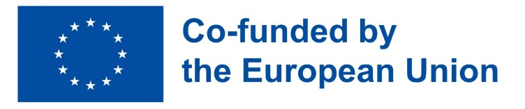
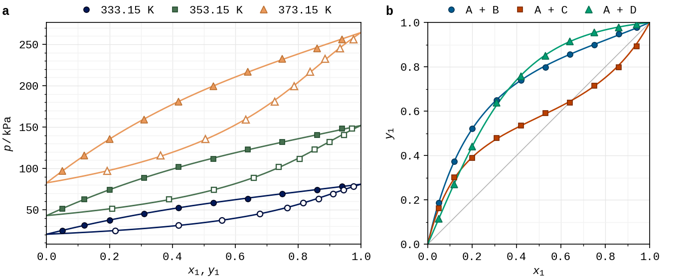
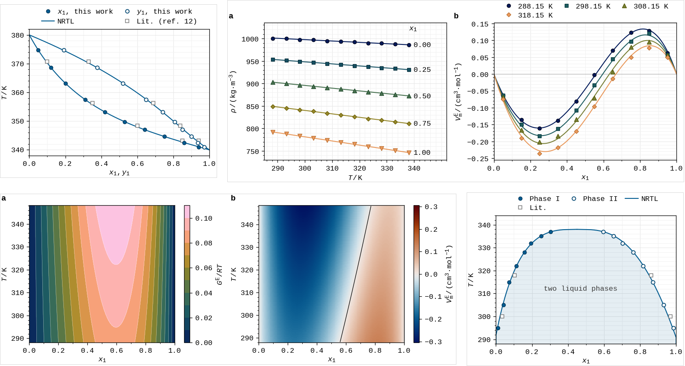
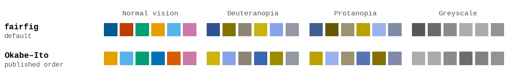
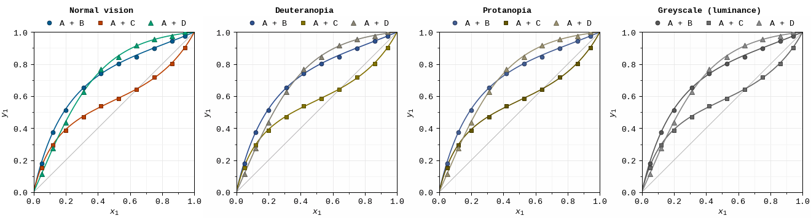

# fairfig

<p>
  
  &nbsp;&nbsp;&nbsp;
  
</p>

**Colour-blind-safe, journal-ready figures with matplotlib.** One line of setup gives
every figure in a paper the same look: colours that stay distinct for colour-blind
readers, the exact column width of your journal, and editable SVG + PDF files.



## Install

```bash
pip install git+https://github.com/usosky/fairfig
```

## Use

```python
import fairfig as ff
ff.use("acs")                                    # or "elsevier", "nature"

fig, ax = ff.figure("single")                    # exact column width
ax.plot(x, T, **ff.points(0), label="$x_1$")     # experiment: markers
ax.plot(y, T, **ff.points(0, hollow=True), label="$y_1$")   # 2nd phase: open markers
ax.plot(xm, Tm, **ff.curve(0), label="NRTL")     # model: line in the same colour
ax.set(xlabel=ff.label("x_1, y_1"), ylabel=ff.label("T", "K"))
ff.legend(ax)                                    # key above the plot
ff.save(fig, "figures/fig1")                     # fig1.svg + fig1.pdf
```

The [cookbook](examples/demo_phase_equilibria.py) has ready recipes for T–x–y, p–x–y, x–y,
LLE, density, excess-volume, deviation and map figures:



## Colour



The **fairfig** palette takes the Okabe–Ito hues and sets the first three colours at three
brightness levels, so they stay apart for colour-blind readers, on small markers and in
greyscale print; a colour-blind reader tested it. To use **Okabe–Ito** as published
instead: `ff.use("acs", palette="okabe-ito")`. Every series also gets its own marker
shape. Ordered series and maps use the batlow and vik colour maps (`ff.ramp(n)`,
`ff.cmap("seq")`).

Before you submit, see the figure the way colour-blind readers do with
`ff.cvd_preview(fig)`:



## Journals

| `ff.use(...)` | single column | double column | text |
|---|---|---|---|
| `"acs"` | 84.6 mm | 177.8 mm | 8 pt |
| `"elsevier"` | 90 mm | 190 mm | 8 pt |
| `"nature"` | 89 mm | 183 mm | 7 pt |

Text is set in the bundled Liberation Mono; Nature asks for a sans-serif face:
`ff.use("nature", font="Arial")`. Submit the PDF and keep the SVG for editing. The full
style guide is [`docs/identity_sheet.pdf`](docs/identity_sheet.pdf).

## Cite

[github.com/usosky/fairfig](https://github.com/usosky/fairfig) (GitHub's "Cite this repository" gives the reference).

## Licence

MIT © 2026 Denis Usosky. The bundled Liberation Mono font (SIL OFL 1.1) and batlow/vik
colour maps (F. Crameri, MIT) keep their own licences ([notices](THIRD_PARTY_NOTICES.md));
the logos in `assets/` are not covered. Release notes: [`CHANGELOG.md`](CHANGELOG.md).

## Acknowledgements

fairfig was developed by [Denis Usosky](https://orcid.org/0000-0002-6245-5110) within the
AuSpire project at IDOM Consulting, Engineering, Architecture S.A.U., together with
[Juan Carlos Latasa López](https://orcid.org/0009-0004-9312-544X),
[Valery Novoa Colas](https://orcid.org/0009-0009-7567-8012),
[Juan Alberto Martín Martín](https://orcid.org/0000-0002-5158-0709), Ana García Algaba and
Abdul Rahim (IDOM) and Aaron Belbasis (Aurecon Australasia). We thank IDOM for supporting
this work, [Lander Laparra](https://gravatar.com/nightagile2dc1fd9bba) for testing the
colours and Petro Pavliuchenko for his support.

Co-funded by the European Union under the Marie Skłodowska-Curie Grant Agreement
No 101177949 (AuSpire). Views and opinions expressed are however those of the author(s)
only and do not necessarily reflect those of the European Union or the Research Executive
Agency. Neither the European Union nor the granting authority can be held responsible
for them.
