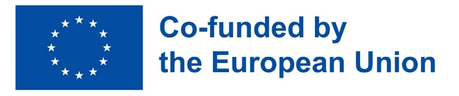

# Cite and acknowledge

## Cite fairfig

If you use fairfig for figures in a publication, please cite it. Every release is
archived on [Zenodo](https://zenodo.org/badge/latestdoi/1418777902), which gives it a
DOI; cite the version you used. The citation, with all authors and their ORCID iDs, is
in [`CITATION.cff`](https://github.com/usosky/fairfig/blob/main/CITATION.cff), and
GitHub's **Cite this repository** button formats it as APA or BibTeX.

Please also cite the colour maps and the palette when you describe your figures:

- Crameri, F. (2018) Scientific colour maps. Zenodo, doi:10.5281/zenodo.1243862
- Crameri, F., Shephard, G. E. & Heron, P. J. (2020) The misuse of colour in science
  communication. *Nat. Commun.* 11, 5444, doi:10.1038/s41467-020-19160-7
- Okabe, M. & Ito, K. (2008) *Color Universal Design*; Wong, B. (2011) Color
  blindness. *Nat. Methods* 8, 441

## Authors and acknowledgements

fairfig was developed by [Denis Usosky](https://orcid.org/0000-0002-6245-5110) within the
AuSpire project at IDOM Consulting, Engineering, Architecture S.A.U., together with
[Juan Carlos Latasa López](https://orcid.org/0009-0004-9312-544X),
[Valery Novoa Colas](https://orcid.org/0009-0009-7567-8012),
[Juan Alberto Martín Martín](https://orcid.org/0000-0002-5158-0709), Ana García Algaba and
Abdul Rahim (IDOM) and Aaron Belbasis (Aurecon Australasia). We thank IDOM for supporting
this work, [Lander Laparra](https://gravatar.com/nightagile2dc1fd9bba) for testing the
colours and Petro Pavliuchenko for his support.

  
  &nbsp;&nbsp;&nbsp;
  

Co-funded by the European Union under the Marie Skłodowska-Curie Grant Agreement
No 101177949 (AuSpire). Views and opinions expressed are however those of the author(s)
only and do not necessarily reflect those of the European Union or the Research Executive
Agency. Neither the European Union nor the granting authority can be held responsible
for them.

## Licence

MIT © 2026 Denis Usosky. The bundled Liberation Mono font (SIL Open Font License 1.1)
and the batlow and vik colour maps (F. Crameri, MIT) keep their own licences
([notices](https://github.com/usosky/fairfig/blob/main/THIRD_PARTY_NOTICES.md)); the
logos in `assets/` are not covered.
