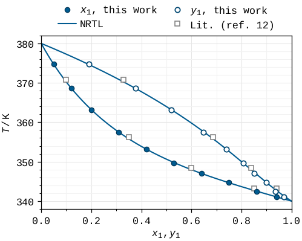
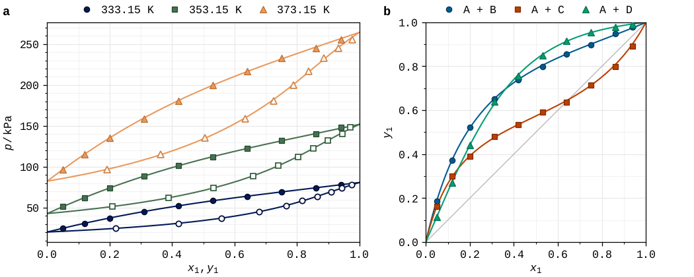
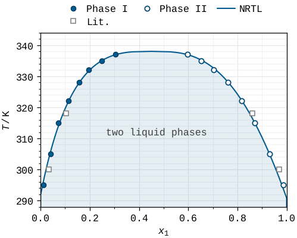
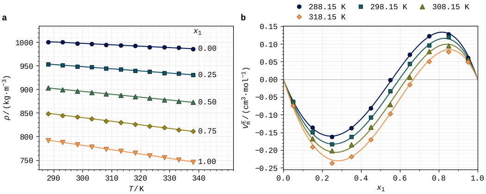
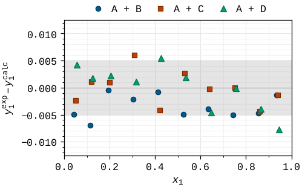
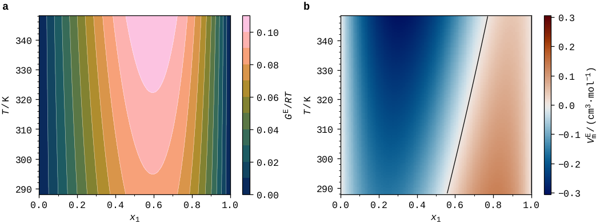

# Cookbook

[`examples/demo_phase_equilibria.py`](https://github.com/usosky/fairfig/blob/main/examples/demo_phase_equilibria.py)
holds a recipe for each common figure of a phase-equilibrium or property paper. Its
data are synthetic (a two-parameter Margules model with Antoine vapour pressures):
replace the arrays with your own and keep the plotting lines. Each recipe writes an SVG
and a PDF to `examples/output/`. The code below is taken from the file; the setup at
its top defines `rng`, `OUT`, the model functions and the arrays `xm` and `xe`.

## T–x–y diagram

Experiment as markers (filled liquid, open vapour), the model as a line in the same
colour, literature data as grey open markers, the key above the plot in your order.



```python
--8<-- "examples/demo_phase_equilibria.py:txy"
```

## p–x–y isotherms and x–y diagram

Ordered isotherms get colours from a ramp; three systems get fixed slots.



```python
--8<-- "examples/demo_phase_equilibria.py:pxy_xy"
```

## Liquid–liquid equilibrium

Phase I filled, phase II open; the two-phase region is a transparent band between two
compositions (`along="y"`).



```python
--8<-- "examples/demo_phase_equilibria.py:lle"
```

## Density and excess volume

Direct labels at the line ends instead of a legend; a ramp for the temperatures.



```python
--8<-- "examples/demo_phase_equilibria.py:density_ve"
```

## Deviations

Residuals of three systems around the zero line, inside a grey uncertainty band.



```python
--8<-- "examples/demo_phase_equilibria.py:deviations"
```

## Maps

batlow for magnitudes, vik for signed values centred at zero; no grid on colour maps.



```python
--8<-- "examples/demo_phase_equilibria.py:maps"
```

## Checks

```python
--8<-- "examples/demo_phase_equilibria.py:checks"
```

## More examples

| Script | Shows |
|---|---|
| [`quickstart.py`](https://github.com/usosky/fairfig/blob/main/examples/quickstart.py) | the shortest complete figure |
| [`journals.py`](https://github.com/usosky/fairfig/blob/main/examples/journals.py) | one figure for ACS, Elsevier and Nature |
| [`check_colours.py`](https://github.com/usosky/fairfig/blob/main/examples/check_colours.py) | the colour checks before submission |
| [`make_identity_sheet.py`](https://github.com/usosky/fairfig/blob/main/examples/make_identity_sheet.py) | the two-page [identity sheet](identity_sheet.pdf) |
