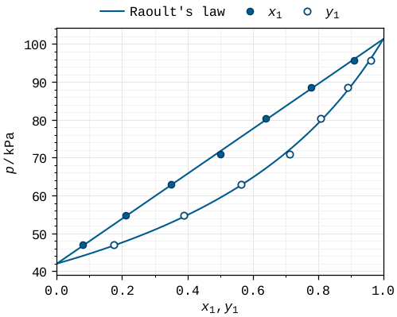

# Getting started

## Install

```bash
pip install fairfig
```

fairfig needs Python 3.9 or newer, matplotlib 3.7 or newer and NumPy. The Liberation
Mono font and the batlow and vik colour maps come with the package, so there is
nothing else to install. The latest development version:

```bash
pip install git+https://github.com/usosky/fairfig
```

## A first figure

[`examples/quickstart.py`](https://github.com/usosky/fairfig/blob/main/examples/quickstart.py)
draws an isothermal p–x–y diagram and saves it for an ACS journal:

```python
--8<-- "examples/quickstart.py:docs"
```



Four calls do the work:

1. `ff.use("acs")` applies the style sheet, the journal preset (column widths, text
   size), the palette and the bundled font. Call it once, before making figures.
2. `ff.figure()` and `ff.subplots()` make figures at the exact column width. Draw at the
   final size: a figure that is scaled later gets the wrong text size.
3. `ff.points(i)` and `ff.curve(i)` return keyword dictionaries for `ax.plot`: slot *i*
   sets the colour and the marker shape. Everything else stays plain matplotlib.
4. `ff.save(fig, "name")` writes `name.svg` and `name.pdf` at the designed size.

## In a notebook

Figures show inline at 150 dpi, which is only the screen preview. Save them with
`ff.save` to get the exact size and the embedded fonts. Before you submit, look at a
figure the way colour-blind readers do:

```python
ff.cvd_preview(fig)
```

The examples are cell scripts (`# %%`): they run cell by cell in VS Code, VSCodium,
Spyder or Jupyter, or as plain scripts.

## The style sheet only

The look without the helper functions:

```python
import matplotlib.pyplot as plt
plt.style.use("fairfig.fairfig")      # or plt.style.use(ff.STYLE)
```

This sets ACS single-column size, 8 pt Liberation Mono, the palette, the grid and the
export settings. Journal presets, the minor grid, the batlow default colour map and
the larger subscripts need `ff.use()`.

## Next

- [Colour](guide/colour.md): the palettes, ordered data and the colour-vision checks.
- [Figures, marks and text](guide/figures.md): sizes, markers and lines, labels,
  legends and panel labels.
- [Cookbook](cookbook.md): ready recipes for phase-equilibrium and property figures.
