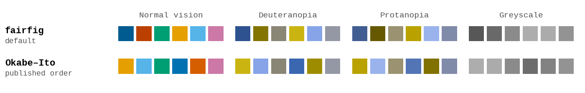
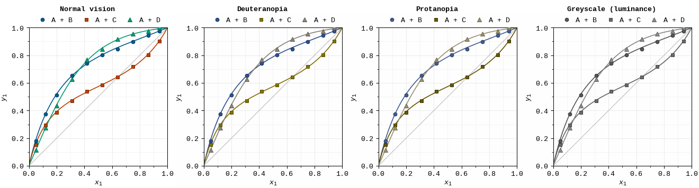

# Colour



## The palette

Six categorical colours in a fixed order. Slot *i* is colour *i* **and** marker shape
*i*, so every series also differs in shape (in code, slots count from 0):

| Slot | `ff.C` name | Fill | Edge | Fill on white | Marker |
|---|---|---|---|---|---|
| 0 | `blue` | `#005B90` | `#013455` | 7.2:1 | circle `o` |
| 1 | `vermillion` | `#BB4000` | `#7C2800` | 5.5:1 | square `s` |
| 2 | `green` | `#009E73` | `#066F50` | 3.4:1 | triangle `^` |
| 3 | `orange` | `#E69F00` | `#AE7809` | 2.3:1 | diamond `D` |
| 4 | `sky` | `#56B4E9` | `#2288BB` | 2.3:1 | triangle `v` |
| 5 | `purple` | `#CC79A7` | `#9E4F7C` | 3.1:1 | pentagon `p` |

The hues are Okabe–Ito (Okabe & Ito 2008; Wong, *Nat. Methods* 8, 441, 2011). fairfig
darkens their blue and vermillion so that the first three slots sit at three
brightness levels: blue–vermillion 1.33:1, vermillion–green 1.60:1, blue–green 2.12:1.
They stay apart where hue is lost: with colour-vision deficiency, on small markers and
in greyscale print. A colour-blind reader tested the colours. Markers get a darker edge
of the same hue (`ff.INK`, made by `ff.ink`), at least 3.8:1 on white, so the light
orange and sky blue stay visible.

To use Okabe–Ito in its published order (orange, sky blue, bluish green, blue,
vermillion, reddish purple; without its black and yellow):

```python
ff.use("acs", palette="okabe-ito")
```

`ff.C.<name>` always gives that hue in the active palette, and `ff.PALETTES` holds both.

### Reserved colours

These never change with the palette:

| `ff.C` | Colour | Use |
|---|---|---|
| `black` | `#000000` | text, axes, a single reference model |
| `grey_dk` | `#404040` | a second model, annotations |
| `grey` | `#808080` | literature and context data (3.9:1 on white) |
| `grey_lt` | `#B3B3B3` | guides: y = x, the zero line |
| `grey_xlt` | `#E6E6E6` | bands and shaded regions |
| `grid`, `grid_minor` | `#E6E6E6`, `#F2F2F2` | major and minor grid, 0.5 pt |
| `yellow` | `#F0E442` | large areas and highlights only: 1.3:1 on white, too faint for lines |

## Colour follows the entity

Give each system or component a slot once, and use the mapping in every figure of the
paper:

```python
S = ff.slots(["A + B", "A + C", "A + D"])        # entity -> slot
ax.plot(x, y, **ff.points(S["A + C"]), label="A + C")
```

More than six entities raise an error: split the figure into panels, or use a ramp if
the series are ordered.

## Ordered data

Isotherms, isobars and compositions are ordered: their colours should get lighter as
the value rises, not jump between hues.

```python
r = ff.ramp(len(temps))                          # dark (low) -> light (high)
for k, T in enumerate(temps):
    ax.plot(x, p[k], **ff.points(k, color=r[k]), label=f"{T:.2f} K")
```

`ff.ramp(n)` samples the batlow colour map and stops at 0.72 of it, so that thin lines
stay visible on white. The marker shape still follows *k*. For maps:

```python
ax.contourf(X, Y, Z, cmap=ff.cmap("seq"))                       # batlow: magnitudes
ax.pcolormesh(X, Y, D, cmap=ff.cmap("div"),                      # vik: signed deviations
              norm=matplotlib.colors.CenteredNorm(0))
```

batlow and vik (Crameri, Shephard & Heron, *Nat. Commun.* 11, 5444, 2020) are
perceptually uniform and stay readable with colour-vision deficiency and in greyscale.
Never use jet or rainbow: their uneven lightness invents features.

## Check before you submit

`ff.cvd_preview(fig)` renders a figure and shows it with deuteranopia, protanopia and
tritanopia (simulated after Machado, Oliveira & Fernandes 2009) and in greyscale:



`ff.save(fig, "fig1", cvd=True)` writes the same check as `fig1_cvd.svg`.

`ff.check_palette()` prints the numbers behind the palette: the contrast of each colour
on white, and for each pair the colour difference (OKLab ΔE × 100) in normal vision and
with each deficiency, and the brightness ratio:

```text
slot   colour  contrast  L(OKLab)
   0  #005B90      7.24     0.454
   1  #BB4000      5.46     0.540
   2  #009E73      3.42     0.620
   3  #E69F00      2.25     0.753  <3:1 -> dark edge + marker shape
   4  #56B4E9      2.31     0.735  <3:1 -> dark edge + marker shape
   5  #CC79A7      3.06     0.679

  pair  normal  deutan  protan  tritan  bright
  0-1     28.9    24.8    18.7    29.9   1.33:1
  0-2     22.6    22.0    22.5    16.3   2.12:1
  ...
  1-2     27.7    11.2    20.5    32.8   1.60:1
  ...
  2-5     25.4     7.5     9.6    23.5   1.12:1  needs distinct marker shapes; same brightness: hard with CVD
```

Rules of thumb that the flags apply:

- contrast ≥ 3:1 on white for lines; lighter colours rely on the dark edge and the
  marker shape;
- ΔE ≥ 8 under colour-vision deficiency (6–8 only with distinct marker shapes) and
  ≥ 15 in normal vision;
- pairs that are close with a deficiency (ΔE < 15) also need a brightness ratio of at
  least 1.25, better 1.5: colour-blind readers and small markers lose hue first and
  brightness last.

It also checks your own colours: `ff.check_palette(["#d62728", "#2ca02c"])` flags
matplotlib's default red and green as too close with deuteranopia (ΔE 4.1).
[`examples/check_colours.py`](https://github.com/usosky/fairfig/blob/main/examples/check_colours.py)
runs all three checks, and `ff.swatches()` draws a palette card.
