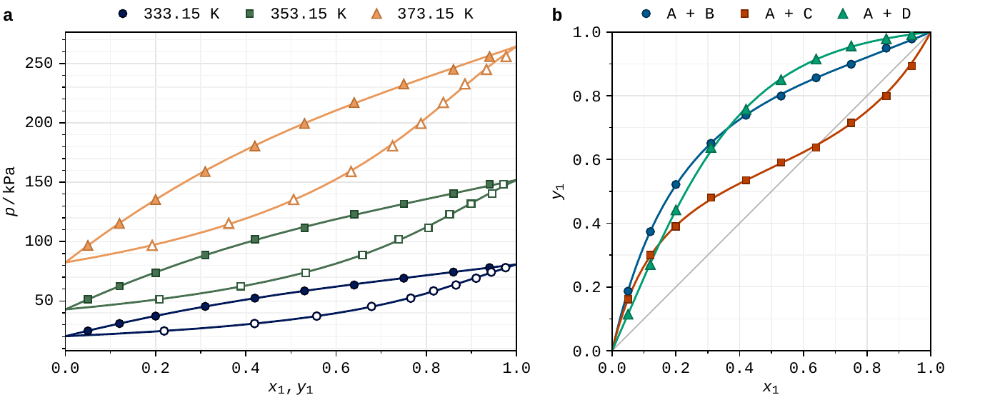
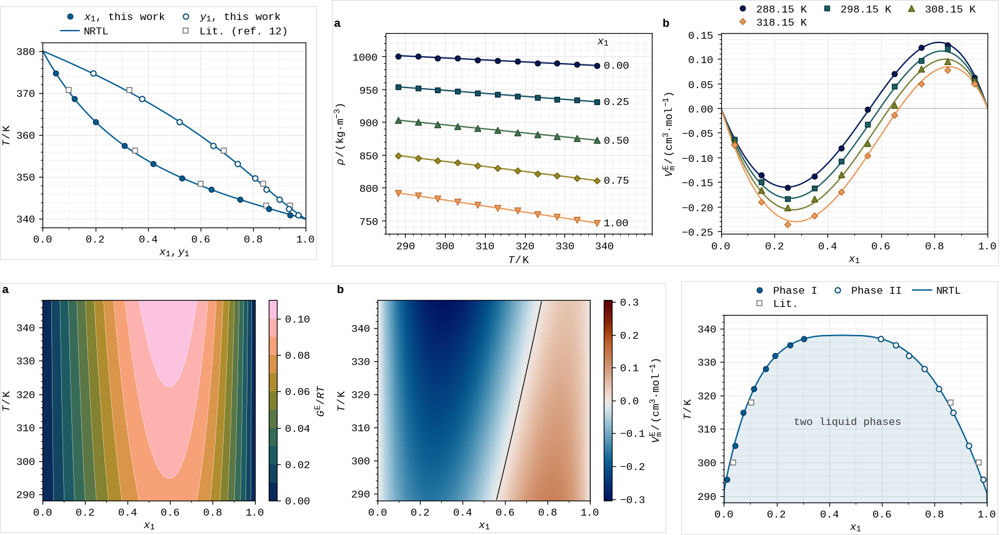

# fairfig

**Colour-blind-safe, journal-ready figures with matplotlib.** One line of setup gives
every figure in a paper the same look: colours that stay distinct for colour-blind
readers, the exact column width of your journal, and editable SVG + PDF files.



```bash
pip install fairfig
```

```python
import fairfig as ff
ff.use("acs")                                    # or "elsevier", "nature"

fig, ax = ff.figure("single")                    # exact column width
ax.plot(x, T, **ff.points(0), label="$x_1$")     # experiment: markers
ax.plot(y, T, **ff.points(0, hollow=True), label="$y_1$")   # 2nd phase: open markers
ax.plot(xm, Tm, **ff.curve(0), label="NRTL")     # model: line in the same colour
ax.set(xlabel=ff.label("x_1, y_1"), ylabel=ff.label("T", "K"))
ff.legend(ax)                                    # key above the plot
ff.save(fig, "figures/fig1")                     # fig1.svg + fig1.pdf
```

## What you get

- **Colours for every reader.** Okabe–Ito hues, ordered so that the first three also
  differ in brightness, and tested by a colour-blind reader. Every series also gets its
  own marker shape. [Colour](guide/colour.md)
- **The journal's size.** Column widths and text sizes of ACS, Elsevier and Nature: draw
  at the final size and never rescale. [Figures, marks and text](guide/figures.md)
- **Files you can edit.** SVG with live text, PDF with embedded fonts, TIFF on request.
  [Saving](guide/saving.md)
- **Checks before you submit.** `ff.cvd_preview(fig)` shows a figure with deuteranopia,
  protanopia, tritanopia and in greyscale; `ff.check_palette()` prints the numbers.
- **Recipes** for T–x–y, p–x–y, x–y, liquid–liquid equilibria, density, excess volume,
  deviations and maps. [Cookbook](cookbook.md)

fairfig sets matplotlib up and hands you keyword dictionaries: you keep full control
of every figure with plain matplotlib calls.



## Cite

If fairfig helps with a publication, please cite it: see [Cite and
acknowledge](citing.md). fairfig was developed within the AuSpire project at IDOM,
co-funded by the European Union (Marie Skłodowska-Curie Grant Agreement No 101177949).
